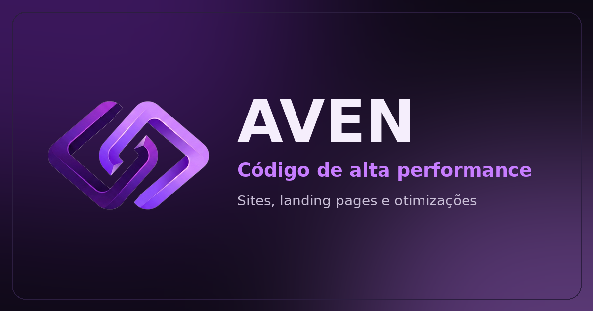

# Aven

**Site institucional da Aven**, empresa de criação de sites, landing pages e otimizações técnicas.

**Veja no ar:** [aven-sooty-ten.vercel.app](https://aven-sooty-ten.vercel.app)

---

## Sobre o projeto

A Aven transforma ideias em sites rápidos e bem cuidados. Este projeto é o cartão de visitas da empresa na internet: uma página única, direta e elegante, que apresenta o que a Aven faz, mostra trabalhos de exemplo e leva o visitante a um contato em poucos toques.

## O objetivo

Dar à Aven uma presença profissional online que:

- explique em segundos o que a empresa oferece;
- passe confiança com um visual moderno e consistente;
- transforme visitas em conversas, com o WhatsApp sempre à mão;
- funcione bem em qualquer tela, do celular ao computador.

## O que foi entregue

Uma página única, organizada em blocos que o visitante percorre naturalmente, de cima para baixo:

**Topo e menu.** A logo da Aven, os atalhos para cada seção e um botão de orçamento sempre visível. No celular, o menu se recolhe em um botão compacto.

**Apresentação.** A primeira tela traz a mensagem principal da marca, "Transformamos ideias em códigos de alta performance", com dois caminhos claros: falar com um especialista pelo WhatsApp ou conhecer os projetos.

**Serviços.** Três cards explicam o que a Aven faz:

- **Criação de Sites:** sites rápidos, responsivos e pensados para serem encontrados.
- **Landing Pages:** páginas de venda de alto impacto, focadas em conversão e campanhas.
- **Ajustes e Otimizações:** melhorias de desempenho e novas funcionalidades em projetos que já existem.

**Portfólio.** Quatro projetos modelo, cada um com imagem da tela inicial, descrição curta, tecnologias usadas e links para ver o projeto no ar e o código:

- **E-commerce Moda:** modelo de loja virtual de moda feminina, masculina e infantil.
- **Nexor:** landing page para agência, com animações ao rolar a página.
- **iRepair:** landing page para assistência técnica de iPhone, com formulário de agendamento.
- **Entre Versos:** plataforma para publicar e ler poemas, com painel administrativo.

**Diferenciais.** Três razões para escolher a Aven: desempenho, código limpo e preparado para crescer, e suporte ágil.

**Contato e rodapé.** Um convite final para pedir orçamento, com botões de WhatsApp e telefone, e o rodapé com os atalhos da página.

## Identidade visual

O site segue a marca da Aven, com um tema escuro em tons de roxo que remete a tecnologia e sofisticação.

- **Cores:** fundo escuro, roxo intenso (`#7B2CBF`) e lavanda (`#C77DFF`) nos destaques.
- **Tipografia:** Space Grotesk, moderna e muito legível, nos títulos e nos textos.
- **Logo:** símbolo 3D em roxo, com facetas e reflexos lavanda, presente no menu e no rodapé.
- **Detalhes:** brilhos suaves e cartões com efeito de luz, para dar profundidade sem poluir.

## Experiência de uso

- **Em qualquer tela:** o layout se adapta ao celular, ao tablet e ao computador.
- **Navegação simples:** tudo está em uma só página, e o menu leva direto a cada seção.
- **Contato imediato:** o botão de orçamento abre o WhatsApp com a mensagem "Olá, quero um orçamento" já preenchida.
- **100% em português do Brasil.**
- **Páginas de erro:** se alguém acessar um endereço que não existe, vê uma mensagem amigável em português, com caminho de volta ao início.

## Feito para ser encontrado e compartilhado

- **Título e descrição** pensados para aparecer bem nos resultados de busca.
- **Prévia de compartilhamento:** ao enviar o link no WhatsApp ou nas redes, aparece uma imagem da marca com o slogan.
- **Endereço oficial indicado** aos buscadores, para evitar duplicidade.

## Tecnologias, em poucas palavras

O site foi construído com ferramentas modernas, escolhidas para dar velocidade e facilitar a manutenção:

- **React e TanStack Start:** a base do site, que carrega rápido e se atualiza com facilidade.
- **Tailwind CSS:** o sistema de estilos que garante um visual uniforme.
- **Vercel:** a hospedagem, com publicação automática a cada atualização aprovada.

## Próximos passos

O site já está no ar, e a evolução prevista inclui:

- e-mail oficial de contato;
- textos definitivos para serviços e diferenciais;
- medição de visitas (analytics);
- domínio próprio.

## Contato

**WhatsApp:** [(81) 9 8375-5704](https://wa.me/5581983755704?text=Ol%C3%A1%2C%20quero%20um%20or%C3%A7amento)

